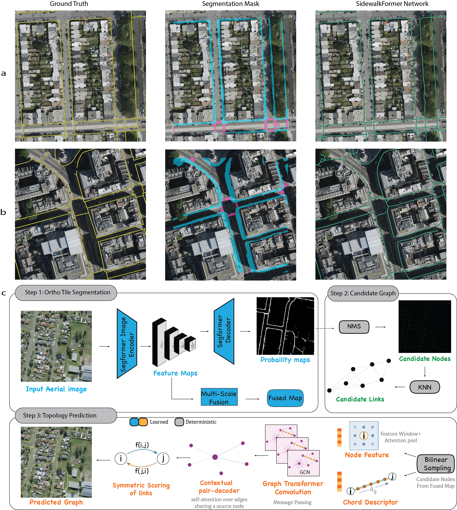

# SidewalkFormer

**Extracting connected pedestrian networks (sidewalks and crossings) from aerial imagery.**

[](LICENSE)


[](https://papers.ssrn.com/sol3/papers.cfm?abstract_id=7662399)

SidewalkFormer reconstructs pedestrian networks (including sidewalks,
crossings, and connecting paths) from high-resolution aerial imagery. Semantic
segmentation and graph topology are predicted jointly, producing a connected,
routable graph rather than a surface mask only. Each edge is labelled by type,
sidewalk or crossing, and retains its prediction probability. Graphs inferred
for individual image tiles are merged into continuous metropolitan-scale
networks.

> **Status:** the paper is under review. A preprint is available on
> [SSRN](https://papers.ssrn.com/sol3/papers.cfm?abstract_id=7662399). Code and
> [trained weights](#pretrained-weights) are released.

## How it works



## Repository structure

```text
Footpath-Network-Extraction/
├── train.py                    # Train SidewalkFormer
├── validate.py                 # Evaluate a checkpoint on the held-out split
├── infer_city.py               # City-scale inference, stitching and GeoJSON export
├── infer_city_fast.py          # Throughput-optimised city-scale runner (same outputs)
├── infer_single.py             # Single-tile inference for inspection/debugging
├── sidewalkformer/             # Core library
│   ├── model.py                #   SidewalkFormer model
│   ├── dataset.py              #   Dataset, patch grids, graph-label generation
│   ├── graph_extraction.py     #   Node proposals from predicted masks
│   ├── graph_utils.py          #   Reference-graph conversion and labelling helpers
│   ├── tile2net_postprocess.py #   Mask → polygon → centreline graph (Tile2Net)
│   └── utils.py                #   Config loading
├── tools/
│   ├── build_manifest.py       # Build an inference manifest from tiles + bboxes
│   └── mask_to_network.py      # Convert any binary sidewalk mask into a network
├── config/
│   ├── sidewalkformer.yaml     # Paper config
│   └── baselines/              # SAM-Road and Tile2Net baseline configs
├── evaluation/                 # Tile preparation, precision/recall/F1
│   └── cityscale_metrics/apls/ #   APLS (Go) and K-APLS + geometry
├── docs/                       # Inference guide
├── figures/                    # Paper overview figure used in this README
├── third_party/                # Vendored SAM-Road and Tile2Net (original licenses)
├── requirements.txt            # Pinned pip dependencies
└── environment.yml             # Conda environment (installs requirements.txt)
```

Checkpoints go in a local `weights/` directory, which you create yourself and
Git ignores (see [Pretrained weights](#pretrained-weights)).

## Installation

Tested with Python 3.10.

```bash
git clone https://github.com/ahimad97/Footpath-Network-Extraction.git
cd Footpath-Network-Extraction
conda env create -f environment.yml
conda activate sidewalkformer
```

The pinned versions in `requirements.txt` match the validated environment. If
the default PyTorch wheel does not match your CUDA/CPU setup, install the right
PyTorch build first. A CUDA GPU is recommended for city-scale inference.
Inference falls back to CPU when no GPU is available.

## Pretrained weights

Checkpoints are not stored in Git. Download the trained SidewalkFormer
checkpoint (~1 GB) and save it as `weights/sidewalkformer.ckpt`:

| Model | Config | Download |
|---|---|---|
| SidewalkFormer (paper) | `config/sidewalkformer.yaml` | [Google Drive](https://drive.google.com/file/d/1HoXGW4HfN_h8KkoK57QqB0uc2Eck0w8G/view?usp=sharing) |

To download from the command line:

```bash
pip install gdown
mkdir -p weights
gdown 1HoXGW4HfN_h8KkoK57QqB0uc2Eck0w8G -O weights/sidewalkformer.ckpt
```

The SegFormer-B5 backbone used to build the model is downloaded automatically
from Hugging Face (`model_name` in the config) the first time a model is
created.

## Quick start: map a city

**0. Download the checkpoint** (see [Pretrained weights](#pretrained-weights)).

**1. Describe your tiles with a manifest.** Each record holds a tile ID, an
image path, and a WGS84 bbox `[west, south, east, north]`. If you have a folder
of tiles and a list of `[south, west, north, east]` boxes in download order,
generate the manifest with:

```bash
python tools/build_manifest.py \
  --bbox_list /path/to/bounds.json \
  --image_dir /path/to/images \
  --output /path/to/manifest.json \
  --strict
```

**2. Run inference.**

```bash
python infer_city.py \
  --config config/sidewalkformer.yaml \
  --checkpoint weights/sidewalkformer.ckpt \
  --manifest /path/to/manifest.json \
  --output_dir /path/to/results
```

**3. Open the result.** `results/global/graph_merged_edges.geojson` loads
directly in QGIS, kepler.gl or GeoPandas.

For very large areas (tens of thousands of tiles), use `infer_city_fast.py`
with the same arguments plus throughput options. Runs are resumable: rerun the
same command to continue. See the [inference guide](docs/INFERENCE.md) for
merge controls, the fast runner, and single-tile debugging.

To turn an existing binary sidewalk mask (from any source) into a network
without the model, use `tools/mask_to_network.py`
(see [docs/INFERENCE.md](docs/INFERENCE.md#from-a-mask-to-a-network-no-model)).

## Outputs

`infer_city.py` writes:

```text
results/
├── tiles/<tile_id>/
│   ├── graph_core.npz        # nodes, edges, edge scores, link types
│   ├── graph_core.p          # pixel adjacency dict (Sat2Graph format)
│   ├── pred_mask_core.npy    # predicted class mask
│   ├── walkmask_core.png
│   ├── graph_viz.png
│   └── meta.json
├── global/
│   ├── graph_merged.npz
│   ├── graph_merged.geojson        # nodes + edges
│   ├── graph_merged_edges.geojson  # LineStrings: link_type, confidence
│   └── graph_merged_nodes.geojson
└── resume_state.json
```

## Citation

The SidewalkFormer paper is under review. Until it is published, please cite
the preprint on SSRN:

> SidewalkFormer preprint, SSRN, abstract ID 7662399.
> <https://papers.ssrn.com/sol3/papers.cfm?abstract_id=7662399>

## License and acknowledgements

SidewalkFormer code is released under the [MIT License](LICENSE).

This project builds on excellent open-source work, vendored under
`third_party/` with the original licenses kept:

- [SAM-Road](https://arxiv.org/abs/2403.16051) (MIT) and
  [Segment Anything](https://github.com/facebookresearch/segment-anything)
  (Apache 2.0)
- [Tile2Net](https://github.com/VIDA-NYU/tile2net) (BSD 3-Clause), including
  NVIDIA-derived segmentation code
- [SegFormer](https://huggingface.co/docs/transformers/model_doc/segformer)
  via Hugging Face Transformers

See [THIRD_PARTY_NOTICES.md](THIRD_PARTY_NOTICES.md) for details. Datasets and
model weights from third parties are subject to their own terms.
